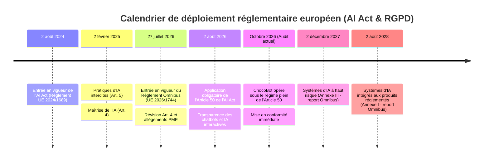
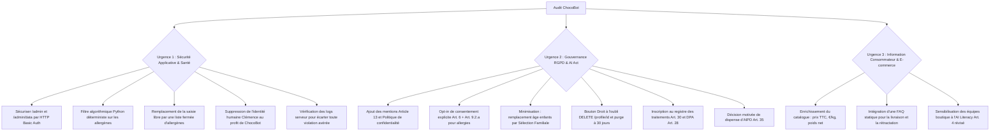

# RAPPORT D'AUDIT JURIDIQUE ET TECHNIQUE · CHOCOBOT (MAISON DELCOURT)

**Date d'audit :** 8 octobre 2026  
**Auditeur :** Cabinet de conseil juridique et technique spécialisé en Droit du Numérique, IA et Réglementation Agroalimentaire  
**Client :** Direction de la Maison Delcourt (Lille)  
**Objet :** Audit de conformité réglementaire de l'assistant IA « ChocoBot » avant le Black Friday et les fêtes de fin d'année  
**Périmètre légal examiné :**
1. **RGPD** (Règlement UE 2016/679) & **Loi Informatique et Libertés** modifiée (notamment Art. 82 relatif aux traceurs et cookies)
2. **AI Act** (Règlement UE 2024/1689), tel que modifié par le **Règlement (UE) 2026/1744** (*Digital Omnibus on AI*)
3. **Règlement INCO** (Règlement UE n° 1169/2011 relatif à l'information des consommateurs sur les denrées alimentaires) & Décret n° 2015-447 (Allergènes)
4. **Droit de la consommation** (Code de la consommation français : obligation générale d'information précontractuelle, indication des prix, pratiques commerciales trompeuses, droit de rétractation)

---

## SYNTHÈSE EXÉCUTIVE ET VERDICT DE CONFORMITÉ

> [!WARNING]
> **VERDICT GLOBAL : NON-CONFORME ET RISQUE JURIDIQUE ÉLEVÉ**  
> En l'état de son code source et de son architecture initiale, le projet ChocoBot présente des **manquements réglementaires et des vulnérabilités techniques majeurs**. Son ouverture au public expose la Maison Delcourt à un **risque juridique élevé** : sanctions financières de la CNIL (Art. 83 RGPD) et au titre de l'AI Act (Art. 99), sanctions de la DGCCRF pour pratiques commerciales trompeuses (Art. L. 132-2 du Code de la consommation), ainsi qu'à une responsabilité civile et pénale en cas d'accident allergique consécutif à une hallucination du modèle de langage sur les allergènes alimentaires.

### Tableau récapitulatif de conformité par pilier

| Pilier Réglementaire | Statut de Conformité | Principaux Risques et Manquements Relevés |
| :--- | :---: | :--- |
| **RGPD** | ❌ **Non-conforme (Majeur)** | Vulnérabilité de sécurité sur les points d'accès `/admin` et `/admin/data` (Art. 32), traitement de données de santé (allergies) sans recueil du consentement explicite préalable (Art. 9.2.a cumulativement à l'Art. 6), collecte disproportionnée de données relatives à des mineurs (Art. 5.1.c et Art. 25), absence des mentions obligatoires d'information (Art. 13) et absence de registre des traitements (Art. 30). |
| **AI Act** | ❌ **Non-conforme (Majeur)** | Manquement à l'obligation de transparence de l'Article 50(1) applicable depuis le 2 août 2026 : simulation d'une identité humaine (« Clémence, conseillère ») dissimulant la nature artificielle de l'assistant. Répartition des rôles Fournisseur / Déployeur à clarifier entre le cabinet intégrateur et la Maison Delcourt (Art. 25). |
| **Règlement INCO** | ❌ **Non-conforme (Sanitaire)** | Risque sanitaire avéré : recours à un LLM probabiliste non filtré pour renseigner les consommateurs sur les allergènes majeurs, absence de gestion des contaminations croisées en atelier artisanal, et risque que les réponses du bot contredisent l'étiquetage légal officiel. |
| **Droit de la Consommation** | ❌ **Non-conforme (Majeur)** | Risque de pratiques commerciales trompeuses (Art. L. 121-2), prix indiqués en entiers bruts sans mention TTC, sans devise et sans prix à l'unité de mesure (€/kg), absence complète d'information sur les délais et tarifs de livraison dans la base du bot (conduisant à des hallucinations factuelles), et défaut d'information sur l'exclusion du droit de rétractation (Art. L. 221-28 4°). |

---

## SECTION PRÉLIMINAIRE · CALENDRIER RÉGLEMENTAIRE ET RÉGIME DE SANCTIONS

L'analyse de conformité s'inscrit dans un calendrier juridique européen récemment actualisé, marqué par l'entrée en application d'échéances clés et par l'adoption de mesures d'harmonisation.

### 1. Calendrier d'application de l'AI Act
* **2 août 2024 :** Entrée en vigueur formelle du Règlement (UE) 2024/1689.
* **2 février 2025 :** Application des interdictions générales relatives aux pratiques d'IA inacceptables (Art. 5) et des premières obligations de maîtrise de l'IA (*AI Literacy*, Art. 4).
* **27 juillet 2026 :** Entrée en vigueur du **Règlement (UE) 2026/1744** (*Digital Omnibus on AI*), qui modifie de manière ciblée l'AI Act :
  - Réécriture de l'article 4 clarifiant la nature de l'obligation de moyens pour la maîtrise de l'IA.
  - Report des échéances de conformité applicables aux systèmes à haut risque (2 décembre 2027 pour l'Annexe III et 2 août 2028 pour l'Annexe I).
  - Allègement des contraintes administratives pour les PME et entreprises à moyenne capitalisation.
* **2 août 2026 :** **Échéance pivot dépassée.** Les obligations de transparence du Titre IV, et spécifiquement **l'Article 50 sur les systèmes d'IA interagissant avec des personnes physiques**, sont entrées en application obligatoire le **2 août 2026**. Par conséquent, à la date de cet audit (octobre 2026), tout manquement à l'article 50 constitue une non-conformité immédiatement sanctionnable.

### 2. Régime des sanctions encourues
Les manquements relevés exposent la Maison Delcourt et ses partenaires à trois niveaux de sanctions administratives et pénales :

* **Sanctions AI Act (Article 99) :**
  - Non-respect des obligations de transparence (Art. 50) : amende administrative pouvant atteindre jusqu'à **15 000 000 €** ou **3 % du chiffre d'affaires annuel mondial total** de l'exercice précédent.
  - *Régime adapté aux PME (Art. 99(6)) :* Pour les PME et entreprises artisanales comme la Maison Delcourt, la sanction est plafonnée au montant le plus bas entre les deux critères, dans le respect du principe de proportionnalité.
* **Sanctions RGPD (Article 83) :**
  - Manquements aux principes fondamentaux (Art. 5), à la licéité (Art. 6), au traitement des données de santé (Art. 9) et aux droits des personnes (Art. 12 à 22) : amende pouvant atteindre **20 000 000 €** ou **4 % du chiffre d'affaires mondial** (Art. 83.5).
  - Manquements aux obligations de sécurité (Art. 32), de sous-traitance (Art. 28) ou de tenue du registre (Art. 30) : amende pouvant atteindre **10 000 000 €** ou **2 % du CA mondial** (Art. 83.4).
* **Sanctions Code de la consommation (Art. L. 132-2) :**
  - Pratiques commerciales trompeuses : peines pouvant aller jusqu'à **2 ans d'emprisonnement** et **300 000 € d'amende**, le montant pouvant être porté à 10 % du chiffre d'affaires moyen annuel.

---

## SECTION 1 · ANALYSE DÉTAILLÉE ARTICLE PAR ARTICLE : RGPD ET LOI INFORMATIQUE ET LIBERTÉS

Ressource de référence : [CNIL - Chapitre 3 du RGPD (Article 13)](https://www.cnil.fr/fr/reglement-europeen-protection-donnees/chapitre3#Article13)

### 1.1. Article 5 · Principes relatifs au traitement des données à caractère personnel
* **Obligation légale :**
  - **Licéité, loyauté, transparence (Art. 5.1.a) :** Traitement loyal et transparent vis-à-vis des personnes.
  - **Limitation des finalités (Art. 5.1.b) :** Données collectées pour des finalités déterminées et légitimes.
  - **Minimisation des données (Art. 5.1.c) :** Données adéquates, pertinentes et limitées au strict nécessaire au regard des finalités.
  - **Limitation de la conservation (Art. 5.1.e) :** Conservation n'excédant pas la durée nécessaire aux finalités.
  - **Intégrité et confidentialité (Art. 5.1.f) :** Protection appropriée contre tout accès non autorisé, altération ou perte.
* **Constat dans ChocoBot :**
  - **Minimisation non respectée :** Dans `app.py, lignes 18-24` et `static/index.html, lignes 61-67`, le formulaire latéral exige le nom complet, l'email et l'âge des enfants (`kids`). Or, pour orienter un consommateur vers un assortiment de chocolats dans une session web interactive éphémère, la collecte systématique de l'identité civile et du courriel est disproportionnée.
  - **Absence de durée de conservation définie :** Dans `db.py, lignes 4-8`, les tables `customers` et `messages` enregistrent les horodatages via un appel standard `time.time()`, sans mécanisme programmé de purge, sans politique d'archivage et sans date limite de conservation.
  - **Défaut de confidentialité et de contrôle des accès :** Dans `app.py, lignes 43-53`, les routes `/admin` et `/admin/data` ne comportent aucun mécanisme d'authentification. Toute personne connaissant l'URL peut accéder aux profils clients, aux adresses électroniques, aux allergies renseignées et aux historiques de discussion. Par ailleurs, dans `chatbot.py, ligne 36`, les données nominatives sont directement écrites dans les flux de sortie standard (`print(f"[chat] {customer} : {message}")`), ce qui contrevient à la confidentialité des journaux applicatifs.
* **Correctifs requis :**
  1. Rendre les champs patronymiques et de contact strictement facultatifs lors de la phase de recommandation conversationnelle.
  2. Instaurer une politique de conservation documentée :
     - *Données de session active :* effacées à la clôture de la navigation si aucune commande n'est initiée.
     - *Historique conversationnel de support :* conservation maximale de **30 jours** à compter de la dernière activité (justifiée par la gestion de la qualité du conseil et le suivi d'éventuels différends précontractuels), suivie d'une purge automatique.
     - *Journaux techniques d'accès et de sécurité :* conservation de **6 mois à 1 an**, strictement séparés des données métier (conformément aux référentiels de sécurité de l'ANSSI et de la CNIL).
  3. Restreindre l'accès à l'administration par une authentification robuste (HTTP Basic avec identifiants sécurisés par variables d'environnement, contrôle de session ou restriction réseau).
  4. Pseudonymiser les logs d'exécution (ex. n'afficher que les 8 premiers caractères du `session_id` et la longueur du message).

---

### 1.2. Articles 6 et 9 · Licéité du traitement et régime des données particulières (Allergies)
* **Obligation légale et articulation juridique :**
  - Tout traitement de données à caractère personnel doit être fondé sur l'une des bases juridiques de **l'Article 6 du RGPD** (ex. mesures précontractuelles Art. 6.1.b, consentement Art. 6.1.a, ou intérêt légitime Art. 6.1.f).
  - Les allergies et intolérances alimentaires constituent juridiquement des **données concernant la santé** au sens de l'Article 4, paragraphe 15 du RGPD, dont le traitement est **interdit par principe** en vertu de **l'Article 9, paragraphe 1**.
  - **Articulation essentielle :** L'article 6 ne remplace pas l'article 9. Pour traiter licitement une donnée de santé, le responsable de traitement doit cumulativement :
    1. Disposer d'une base juridique au titre de l'**Article 6** (en l'espèce, le consentement de l'intéressé selon l'Art. 6.1.a) ;
    2. Lever l'interdiction de l'Article 9.1 en satisfaisant à l'une des dérogations strictes de **l'Article 9, paragraphe 2**, à savoir le **consentement explicite** de la personne concernée pour une finalité spécifique (Art. 9.2.a).
* **Constat dans ChocoBot :**
  - Dans `static/index.html, ligne 65`, le champ `allergies` invite l'utilisateur à déclarer en texte libre ses contraintes médicales alimentaires.
  - Ces informations de santé sont persistées en clair dans la table `customers` (`db.py, lignes 4-5`) et exposées sur l'endpoint `/admin/data`.
  - Aucun recueil préalable de consentement explicite, spécifique et distinct n'est mis en œuvre lors de la soumission du formulaire (`static/index.html, ligne 67`).
* **Correctifs requis :**
  1. Formaliser la base légale : intérêt légitime / mesure précontractuelle (Art. 6.1.b/f) pour les préférences d'achat génériques (budget, goûts chocolat noir/lait), et **consentement explicite préalable (Art. 6.1.a combiné à l'Art. 9.2.a)** pour toute donnée d'allergie ou d'intolérance.
  2. Ajouter une case à cocher d'opt-in dédiée, non pré-cochée et obligatoire dès lors que le champ allergie est renseigné : *« J'accepte expressément que la Maison Delcourt traite l'information relative à mes allergies alimentaires dans le seul but de filtrer les coffrets de chocolats adaptés à ma situation. »*
  3. Côté backend (`app.py`), rejeter systématiquement avec un code HTTP `400 Bad Request` tout enregistrement d'allergie si l'indicateur de consentement explicite n'est pas transmis à l'API.

---

### 1.3. Article 7 · Conditions applicables au consentement et effectivité du retrait
* **Obligation légale :** Lorsque le traitement repose sur le consentement, le responsable du traitement doit pouvoir en démontrer l'obtention (acte positif clair, liberté de choix, granularité). La personne doit pouvoir retirer son consentement à tout moment, aussi simplement qu'elle l'a donné (Art. 7.3).
* **Constat dans ChocoBot :**
  - Absence d'opt-in dans l'interface de saisie (`static/index.html, lignes 61-69`).
  - **Manquement structurel sur le retrait :** Le bouton « Nouvelle conversation » (`static/index.html, lignes 127-131`) se borne à réinitialiser la clé `localStorage.sid` dans le navigateur client. **Il ne supprime aucune donnée sur le serveur.** Les profils clients, adresses emails et historiques de discussion demeurent conservés indéfiniment dans la base SQLite locale `chocobot.db`. L'utilisateur est ainsi trompé sur l'effectivité de la réinitialisation de son échange.
* **Correctifs requis :**
  1. Introduire un mécanisme d'effacement direct côté serveur : bouton *« Effacer mes données »* invoquant une route d'API dédiée (`DELETE /profile/{session_id}`).
  2. Supprimer immédiatement et conjointement les entrées associées dans les tables `customers` et `messages`.

---

### 1.4. Protection des données relatives aux mineurs : Articles 5.1.c, 25 et Considérant 38 (Rectification sur l'Article 8)
* **Obligation légale et requalification du fondement juridique :**
  - L'Article 8 du RGPD vise spécifiquement les conditions applicables au consentement direct d'un mineur pour les services de la société de l'information (ex. inscription directe d'un adolescent sur une plateforme). Il ne s'applique pas directement lorsqu'un parent adulte commande ou demande un conseil pour son foyer.
  - En revanche, la collecte de l'âge précis des enfants doit être examinée au regard des fondements suivants :
    - **Le principe de minimisation des données (Art. 5.1.c du RGPD) :** Collecter l'âge exact de mineurs tiers est excessif pour recommander une boîte de confiseries.
    - **La protection des données dès la conception et par défaut (Art. 25 du RGPD) :** Les formulaires doivent être configurés pour ne pas solliciter de données inutiles.
    - **Le Considérant 38 du RGPD :** Les enfants méritent une protection spécifique de leurs données à caractère personnel.
* **Constat dans ChocoBot :**
  - Le formulaire comporte le champ textuel `Âge des enfants` (`children_ages`) (`static/index.html, ligne 66` et `app.py, ligne 23`), créant un stockage non justifié d'informations personnelles relatives à des mineurs.
* **Correctifs requis :**
  1. Supprimer le champ de saisie de l'âge des enfants.
  2. Remplacer ce champ par une option fonctionnelle non nominative : une simple case à cocher *« Sélection adaptée à un public familial / enfants »* permettant d'orienter le conseil (chocolats plus doux, sans alcool, formes ludiques) sans enregistrer d'attribut individuel sur des mineurs.

---

### 1.5. Articles 12 et 13 · Transparence et Droit à l'information du consommateur
* **Obligation légale :** Lorsque des données sont collectées directement auprès de la personne concernée, le responsable du traitement doit lui fournir, dès la collecte, les informations exhaustives listées à l'Article 13 :
  1. Identité et coordonnées du responsable du traitement (Maison Delcourt SAS) ;
  2. Coordonnées du DPO ou du référent protection des données ;
  3. Finalités précises et bases juridiques respectives (Art. 6.1.b pour le conseil, Art. 6.1.a + 9.2.a pour les allergies) ;
  4. Destinataires ou catégories de destinataires habilités ;
  5. Durées de conservation précises (30 jours max pour les sessions inactives de support) ;
  6. Droits d'accès, rectification, effacement, limitation, opposition et portabilité ;
  7. Droit de retirer son consentement à tout moment ;
  8. Droit d'introduire une réclamation auprès de la CNIL ;
  9. Information claire sur la logique de recommandation algorithmique mise en œuvre.
* **Constat dans ChocoBot :**
  - **Absence totale de politique de confidentialité et de mentions d'information :** `static/index.html` ne comporte aucun lien vers une politique de confidentialité, aucune mention légale sous le formulaire et aucun avis dans l'interface de messagerie.
* **Correctifs requis :**
  1. Insérer un bandeau d'information synthétique sous le formulaire et dans le bas de page du chat.
  2. Publier une page de Politique de Confidentialité dédiée reprenant l'intégralité des 9 mentions obligatoires de l'Article 13.
  3. Exposer clairement au client qu'un algorithme de filtrage et d'aide à la décision traite ses critères pour lui proposer des coffrets adaptés.

---

### 1.6. Articles 15 à 21 · Exercice des droits de la personne concernée
* **Obligation légale :** Garantir à toute personne physique l'exercice effectif de son droit d'accès (Art. 15), de rectification (Art. 16), d'effacement / droit à l'oubli (Art. 17), de limitation (Art. 18) et d'opposition (Art. 21).
* **Constat dans ChocoBot :**
  - Aucun mécanisme d'exercice des droits n'est proposé aux utilisateurs.
  - L'application ne fournit aucune interface ni route backend permettant à un client d'extraire ses données ou de solliciter leur purge.
* **Correctifs requis :**
  1. Mentionner une adresse de contact dédiée dans les mentions légales (ex. `dpo@maison-delcourt.fr`).
  2. Implémenter l'endpoint technique `DELETE /profile/{session_id}` permettant l'exercice immédiat du droit à l'effacement.

---

### 1.7. Article 22 vs Article 13 · Décision individuelle automatisée et profilage (Clarification juridique)
* **Obligation légale et champ d'application :**
  - L'Article 22 du RGPD interdit de soumettre une personne à une décision fondée *exclusivement* sur un traitement automatisé, y compris le profilage, produisant des **effets juridiques** à son égard ou l'affectant de manière **significative similaire** (ex. refus d'un crédit bancaire, exclusion d'une prestation sociale, recrutement automatisé).
  - **Clarification juridique essentielle :** Une recommandation commerciale de coffrets de chocolats ne produit **aucun effet juridique** et n'affecte pas le consommateur de manière significative au sens de l'Article 22. Le client demeure entièrement libre d'acheter ou de refuser les assortiments proposés. **L'Article 22 ne s'applique donc pas à ChocoBot.**
  - En revanche, l'opération consistant à croiser budget, goûts et allergies pour suggérer des produits constitue un **profilage simple à visée commerciale**. L'obligation de transparence qui en découle relève de **l'Article 13.2.f du RGPD**, imposant d'informer l'utilisateur sur la logique sous-jacente du traitement.
* **Constat dans ChocoBot :**
  - Dans `chatbot.py, lignes 16-30`, l'assistant profile l'utilisateur en injectant son budget, ses contraintes et ses préférences dans le prompt du modèle de langage.
  - Aucune information n'explique à l'internaute que cette suggestion découle d'un traitement automatisé de ses critères déclarés.
* **Correctifs requis :**
  1. Informer en amont le consommateur que les recommandations découlent d'un traitement algorithmique de ses préférences déclarées.
  2. Permettre au consommateur d'accéder à l'ensemble du catalogue brut sans passer par le filtre de l'assistant.

---

### 1.8. Article 25 · Protection des données dès la conception et par défaut (Privacy by Design)
* **Obligation légale :** Le responsable du traitement doit mettre en œuvre, tant au moment de la conception du traitement qu'au moment de son exécution, des mesures techniques et organisationnelles appropriées destinées à appliquer efficacement les principes de protection des données (minimisation, limitation des durées, sécurité).
* **Constat dans ChocoBot :**
  - Le système a été conçu sans intégrer ces exigences à la source : champs de saisie excessifs, persistance non bornée en base SQLite, absence d'authentification sur le back-office, et transmission non filtrée de données au modèle d'IA.
* **Correctifs requis :**
  1. Intégrer les principes de *Privacy by Design* dans l'architecture logicielle : filtrage préalable côté client et serveur, minimisation stricte des prompts envoyés au modèle, et purge automatisée programmée.

---

### 1.9. Article 28 · Encadrement contractuel de la sous-traitance technique
* **Obligation légale :** Lorsque le traitement est effectué par un sous-traitant (prestataire informatique, cabinet d'intégration, hébergeur), ce traitement doit être régi par un contrat écrit conforme à l'Article 28, précisant l'objet, la durée, la nature et la finalité du traitement, ainsi que les obligations de sécurité et de confidentialité.
* **Constat dans ChocoBot :**
  - Le système a été conçu et configuré par un cabinet externe pour la Maison Delcourt.
  - En l'absence de formalisation contractuelle des clauses RGPD relatives au développement et à la maintenance du bot, la Maison Delcourt et son prestataire encourent un manquement aux exigences de l'Article 28.
* **Correctifs requis :**
  1. Conclure un accord de traitement de données (DPA - *Data Processing Agreement*) entre la Maison Delcourt et le cabinet prestataire, définissant formellement les engagements de conformité et de confidentialité.
  2. Valider l'absence de transfert de données vers des services tiers lors de l'exécution locale du modèle.

---

### 1.10. Article 30 · Registre des activités de traitement
* **Obligation légale :** Tout responsable de traitement doit tenir un registre recensant l'ensemble des activités de traitement effectuées sous sa responsabilité (Art. 30.1).
  - *Champ d'application pour les PME (Art. 30.5) :* Bien que les entreprises de moins de 250 salariés bénéficient en principe d'une dispense partielle, celle-ci **est inapplicable** dès lors que le traitement n'est pas occasionnel ou comporte des **données sensibles relevant de l'Article 9** (données de santé / allergies). La tenue du registre est donc **strictement obligatoire** pour la Maison Delcourt.
* **Constat dans ChocoBot :**
  - Le traitement opéré par ChocoBot ne figure dans aucun registre formalisé au sein de la Maison Delcourt.
* **Correctifs requis :**
  1. Consigner sans délai la fiche de traitement « ChocoBot » dans le registre interne de la Maison Delcourt (finalités, base juridique Art. 6 et 9.2.a, catégories de données, destinataires internes, politique de conservation de 30 jours, mesures de sécurité de l'Art. 32).

---

### 1.11. Article 32 · Sécurité des traitements et analyse de la menace d'injection de prompt
* **Obligation légale :** Mettre en œuvre des mesures techniques et organisationnelles appropriées afin de garantir un niveau de sécurité adapté au risque (contrôle des accès, chiffrement, gestion des vulnérabilités, confinement des traitements).
* **Constat dans ChocoBot :**
  - **Absence de contrôle d'accès :** Les routes `/admin` et `/admin/data` (`app.py, lignes 43-53`) sont accessibles publiquement sans aucun mot de passe ni jeton d'authentification.
  - **Stockage en clair :** Le fichier SQLite `chocobot.db` est stocké sur disque sans chiffrement au repos.
* **Analyse réaliste du risque de Prompt Injection :**
  - Dans l'architecture technique de ChocoBot, le prompt système n'intègre que les données de la session de l'utilisateur courant et le catalogue local `data/catalog.json`.
  - **Risque intrinsèquement circonscrit :** Il n'existe pas de risque d'injection indirecte (absence de sources externes non maîtrisées ou d'appels web) ni de risque de fuite de données inter-utilisateurs via le prompt. Le risque d'injection directe (tentative par l'utilisateur de manipuler le comportement de l'assistant) est donc limité à sa propre session.
  - **Limites du nettoyage des entrées :** Une simple « sanitization » (filtrage par expressions régulières ou liste noire de mots-clés) est notoirement inopérante face à la diversité expressive du langage naturel et ne protège pas efficacement contre les contournements (jailbreaks).
  - **Mesures de confinement réellement efficaces :**
    1. *Principe du moindre privilège et cloisonnement d'exécution :* Le modèle LLM fonctionne en **lecture seule stricte**. Il ne dispose d'aucun outil d'exécution (*tool calling*), d'aucun accès au système de fichiers ni de connexion directe à la base SQLite.
    2. *Validation déterministe en sortie (Guardrails stricts) :* Ne jamais confier au modèle la prise de décision sur les prix, les stocks ou les allergènes. Ces contrôles doivent être exécutés par du code Python déterministe en aval ou en amont.
    3. *Délimitation structurelle du prompt :* Isoler rigoureusement les variables utilisateurs dans le prompt système à l'aide de balises strictes (ex. `<user_preferences>...</user_preferences>`) et instruire le modèle de ne jamais exécuter de commandes contenues à l'intérieur de ces balises.
* **Correctifs requis :**
  1. Verrouiller immédiatement `/admin` et `/admin/data` par une authentification HTTP Basic sécurisée.
  2. Implémenter le confinement structurel du prompt et la validation algorithmique en sortie.

---

### 1.12. Articles 33 et 34 · Distinction entre vulnérabilité technique et violation de données personnelles
* **Obligation légale et qualification juridique :**
  - Une vulnérabilité de sécurité (point d'accès non protégé, absence d'authentification) constitue en premier lieu un **manquement à l'obligation de sécurité de l'Article 32 du RGPD**.
  - Elle ne constitue une **violation de données à caractère personnel** (*data breach* au sens de l'Article 4, paragraphe 12) que si un incident de sécurité entraîne, de manière avérée ou hautement probable, l'accès non autorisé, la divulgation, l'altération ou la destruction de données à caractère personnel.
  - Si une violation est constatée et présente un risque pour les droits et libertés, elle doit être notifiée à la CNIL dans un délai maximal de 72 heures (Art. 33), et communiquée aux personnes concernées en cas de risque élevé (Art. 34).
* **Constat dans ChocoBot :**
  - L'ouverture publique sans authentification des routes `/admin` et `/admin/data` caractérise une **vulnérabilité critique de sécurité (Art. 32)**.
  - À ce stade d'audit en pré-déploiement, une violation avérée n'est caractérisée que si des tiers extérieurs non autorisés ont effectivement accédé à ces routes sur un serveur exposé à Internet.
* **Correctifs requis :**
  1. Conduire un audit immédiat des journaux d'accès serveur (logs HTTP) pour vérifier si des requêtes non autorisées ont interrogé `/admin/data`.
  2. Si des accès tiers non autorisés sont établis sur des données réelles de clients, documenter l'incident et notifier la CNIL sous 72 heures (Art. 33).
  3. Si aucun accès tiers n'a eu lieu ou si l'exposition s'est limitée à un environnement de test local / pré-production, consigner la vulnérabilité et sa remédiation technique immédiate dans le registre interne des incidents de sécurité (Art. 33.5), sans notification publique inopportune.

---

### 1.13. Article 35 · Analyse d'Impact relative à la Protection des Données (AIPD) et décision motivée
* **Obligation légale :** Une AIPD est requise lorsqu'un traitement est susceptible d'engendrer un risque élevé pour les droits et libertés des personnes physiques, notamment en cas de combinaison d'au moins 2 critères issus des lignes directrices européennes du CEPD (données sensibles, personnes vulnérables, technologies innovantes, profilage).
* **Analyse de proportionnalité dans ChocoBot :**
  - Dans la version initiale non corrigée, le traitement cumulait la collecte de données de santé (allergies), de données relatives à des mineurs (âge des enfants) et l'usage d'une IA générative sans garde-fous.
  - **Décision motivée de dispense conditionnelle d'AIPD :**
    - Dès lors que les mesures de remédiation préconisées sont appliquées :
      1. Remplacement de la collecte des données de mineurs par une option d'usage familial non nominative ;
      2. Traitement local du modèle (zéro transfert hors UE) ;
      3. Sécurisation déterministe en Python du filtrage des allergènes (le LLM ne tranche plus sur la santé) ;
      4. Verrouillage strict des accès d'administration et purge automatique à 30 jours ;
    - Le traitement se résume à une aide à la vente interactive en local sans décision automatisée à impact significatif. Le niveau de risque résiduel repasse sous le seuil imposant une AIPD lourde.
* **Recommandation :**
  1. Soit formaliser une **décision motivée de dispense d'AIPD** signée par la direction et le référent données, consignant les garanties compensatoires mises en œuvre ;
  2. Soit, par rigueur de gouvernance, conduire une AIPD simplifiée via l'outil open-source PIA de la CNIL pour attester de la maîtrise complète des risques.

---

### 1.14. Article 82 de la Loi Informatique et Libertés · Statut de l'identifiant de session (`localStorage.sid`)
* **Obligation légale (Transposition de la Directive ePrivacy 2002/58/CE) :**
  - L'accès ou l'inscription d'informations dans le terminal d'un utilisateur (cookies, stockage local `localStorage`) requiert en principe le consentement préalable de l'utilisateur.
  - **Exception légale :** Les traceurs et identifiants techniques sont **exemptés de consentement préalable** dès lors qu'ils ont pour finalité exclusive de permettre ou faciliter la communication par voie électronique, ou sont **strictement nécessaires à la fourniture d'un service de communication en ligne expressément demandé par l'utilisateur**.
* **Constat et qualification dans ChocoBot :**
  - L'application stocke un identifiant de session aléatoire dans le navigateur via `localStorage.sid` (`static/index.html, lignes 97-101`) pour maintenir le fil de conversation lors de la navigation de l'internaute.
  - Cet identifiant est **strictement nécessaire au fonctionnement du service de chat expressément sollicité** par l'utilisateur.
  - Il bénéficie par conséquent de **l'exemption légale de consentement préalable** au titre de l'article 82 de la Loi Informatique et Libertés.
* **Correctifs requis :**
  1. Documenter clairement l'usage exclusif de ce traceur technique fonctionnel dans la Politique de Confidentialité.
  2. Veiller à ce que cet identifiant ne soit jamais corrélé à des outils de traçage publicitaire ou de suivi d'audience tiers (*cross-site tracking*).
  3. Purger la clé `localStorage.sid` lorsque l'utilisateur clique sur le bouton *« Effacer mes données »*.

---

## SECTION 2 · ANALYSE DÉTAILLÉE ARTICLE PAR ARTICLE : AI ACT (RÈGLEMENT UE 2024/1689 & RÈGLEMENT UE 2026/1744)

Ressource de référence : [AI Act Explorer](https://artificialintelligenceact.eu/fr/ai-act-explorer/)

### 2.1. Qualification juridique des rôles et gouvernance de la chaîne de valeur
La détermination des responsabilités légales au titre de l'AI Act impose une distinction claire entre les acteurs :

* **Le Fournisseur (*Provider* - Art. 3(3) de l'AI Act) :**
  - Personne physique ou morale qui développe un système d'IA ou le fait développer, et le met sur le marché ou le met en service sous son propre nom ou sa propre marque.
  - En l'espèce, **le cabinet / prestataire technique ayant développé, paramétré le prompt et assemblé l'architecture ChocoBot endosse le statut de Fournisseur** du système applicatif.
  - *Modèle sous-jacent :* Meta agit en qualité de fournisseur du modèle de fondation à usage général (*GPAI*) Llama 3.2.
* **Le Déployeur (*Deployer* - Art. 3(4) de l'AI Act) :**
  - Personne physique ou morale qui utilise un système d'IA sous sa propre autorité dans le cadre de son activité professionnelle.
  - **La Maison Delcourt est Déployeur** de ChocoBot.
* **Attention au risque de requalification du déployeur en fournisseur (Article 25 de l'AI Act) :**
  - L'article 25 dispose que tout déployeur est **requalifié en fournisseur** et soumis à l'ensemble des obligations de ce statut dès lors qu'il :
    1. Appose son nom ou sa marque sur un système d'IA déjà mis sur le marché ;
    2. Modifie substantiellement le système d'IA ;
    3. Modifie la destination d'un système d'IA.
  - La Maison Delcourt présentant ChocoBot sous son enseigne exclusive, elle assume une co-responsabilité étroite et doit s'assurer que les exigences de conception du système sont rigoureusement satisfaites.
* **Respect de la licence du modèle Meta Llama 3.2 :**
  - Le modèle Llama 3.2 est distribué sous la licence communautaire *Meta Llama 3.2 Community License Agreement*.
  - *Conditions d'exploitation :*
    1. La licence autorise l'usage commercial sous réserve de ne pas dépasser 700 millions d'utilisateurs actifs mensuels (seuil sans commune mesure avec la Maison Delcourt) ;
    2. Respect strict de la Politique d'utilisation acceptable de Meta (*Acceptable Use Policy*) ;
    3. Obligation d'inclure la mention d'attribution requise par Meta (*« Built with Meta Llama 3 »*) dans la documentation et les crédits du système.
* **Traitement local et souveraineté des données :**
  - L'exécution du modèle Llama 3.2 via Ollama sur l'infrastructure locale garantit l'absence de transfert de données vers des serveurs tiers hors Union Européenne, ce qui constitue un atout de conformité majeur tant pour le RGPD (Chapitre V) que pour la confidentialité opérationnelle.

---

### 2.2. Article 50, paragraphe 1 · Transparence des systèmes d'IA interagissant avec des personnes physiques
* **Obligation légale et articulation Fournisseur / Déployeur :**
  - L'Article 50(1) dispose textuellement : *« Les fournisseurs veillent à ce que les systèmes d'IA destinés à interagir directement avec des personnes physiques soient conçus et développés de manière à ce que les personnes physiques concernées soient informées qu'elles interagissent avec un système d'IA, à moins que cela ne ressorte clairement du contexte et des circonstances d'utilisation. »*
  - **Conséquence juridique :** L'obligation de conception pèse au premier chef sur le **fournisseur** (le cabinet intégrateur), qui a l'obligation légale de livrer un assistant nativement transparent. En tant que **déployeur**, la Maison Delcourt a quant à elle l'obligation d'exploiter le système de façon loyale et de ne pas entraver cette transparence lors de l'interaction avec le public.
  - Cette disposition est **pleinement applicable depuis le 2 août 2026**.
* **Constat dans ChocoBot :**
  - **Manquement caractérisé à la transparence :**
    - Dans `chatbot.py, ligne 8`, le prompt système prescrit explicitement : `Tu es Clémence, conseillère à la Maison Delcourt, chocolatier artisanal à Lille.`
    - Dans `static/index.html, lignes 80 et 85`, la bulle de chat est étiquetée `Clémence · Maison Delcourt` et le message d'amorce énonce : `Bonjour, je suis Clémence, conseillère à la Maison Delcourt. Pour quelle occasion cherchez-vous des chocolats ?`
    - Cette formulation simule de manière délibérée une interlocutrice humaine, masquant la nature artificielle de l'assistant et privant le consommateur de l'information préalable requise par l'article 50(1).
* **Correctifs requis :**
  1. Modifier l'ensemble des éléments textuels et graphiques de l'interface : remplacer « Clémence » par une désignation transparente telle que *« ChocoBot · Assistant virtuel automatisé de la Maison Delcourt »*.
  2. Ajuster l'instruction système dans `chatbot.py` : interdire formellement toute allégation d'identité humaine et instruire le modèle de confirmer sa nature d'intelligence artificielle automatisée dès que la question lui est posée.
  3. Insérer un bandeau permanent au-dessus de la fenêtre d'échange : *« Information AI Act (Art. 50) : Vous échangez avec un assistant virtuel d'intelligence artificielle automatisé. »*

---

### 2.3. Article 50, paragraphes 2 et 4 · Champ d'application des contenus générés (Rectification)
* **Obligation légale et délimitation du champ d'application :**
  - L'Article 50(4) de l'AI Act impose aux déployeurs de systèmes d'IA qui génèrent ou manipulent du texte de marquer ces contenus lorsqu'ils sont *« publiés dans le but d'informer le public sur des questions d'intérêt public »* (débats d'actualité, information politique, journalisme, processus démocratiques).
  - **Clarification juridique essentielle :** Les réponses privées fournies par un chatbot e-commerce à un consommateur pour le conseiller sur des assortiments de confiseries ne constituent pas des publications destinées à informer le public sur des questions d'intérêt public. **L'Article 50(4) ne s'applique donc pas à ChocoBot.**
  - De même, l'Article 50(2) vise le marquage machine-readable des contenus audio, image ou vidéo (*deepfakes*) et ne concerne pas les flux textuels d'un chatbot commercial.
* **Recommandation en termes de bonne pratique :**
  - L'apposition d'un avertissement sous les réponses générées (invitant à vérifier l'étiquetage en boutique) relève d'une **bonne pratique de transparence commerciale et de précaution sanitaire**, mais ne constitue pas une obligation légale au titre de l'Article 50.

---

### 2.4. Article 4 · Maîtrise de l'IA (*AI Literacy*) modifié par le Règlement (UE) 2026/1744
* **Obligation légale et nouvelle formulation en vigueur :**
  - L'Article 4 a fait l'objet d'une réécriture ciblée par le **Règlement (UE) 2026/1744 du 24 juillet 2026** (*Digital Omnibus on AI*, entré en vigueur le **27 juillet 2026**).
  - *Formulation actuelle :* Les fournisseurs et déployeurs de systèmes d'IA prennent des mesures proportionnées pour encourager et garantir un niveau suffisant de maîtrise de l'IA au sein de leur personnel et des personnes exploitant ces systèmes pour leur compte. Le texte précise formellement qu'il s'agit d'une **obligation de moyens** adaptée au contexte organisationnel, à la taille de l'entité, aux compétences techniques et aux fonctions des personnels, sans imposer d'obligation de résultat quant à un niveau d'expertise individuel prédéterminé.
* **Constat et point de vigilance dans ChocoBot :**
  - Compte tenu du lancement en urgence décrit dans le contexte opérationnel, **il est vraisemblable que les équipes de vente en boutique et le personnel d'administration n'aient pas encore bénéficié d'une sensibilisation formalisée** aux caractéristiques des modèles de langage (nature probabiliste, risques d'hallucinations, limites de fiabilité sur les ingrédients).
* **Correctifs requis :**
  1. Élaborer une fiche mémo pratique à destination des vendeurs des trois boutiques lilloises expliquant le rôle de ChocoBot et les conduites à tenir si un client se présente avec une recommandation du bot.
  2. Prévoir une procédure d'orientation vers un interlocuteur humain qualifié dès lors qu'un client exprime une allergie sévère ou une demande complexe.

---

## SECTION 3 · ANALYSE DÉTAILLÉE ARTICLE PAR ARTICLE : RÈGLEMENT INCO (UE N° 1169/2011) ET SÉCURITÉ ALIMENTAIRE

Ressource de référence : [Service Public Entreprendre - F32192 (Allergènes alimentaires)](https://entreprendre.service-public.gouv.fr/vosdroits/F32192)

### 3.0. Distinction fondamentale : Base de données du bot versus Étiquetage légal
* **Portée juridique préalable :**
  - Le fichier de configuration `data/catalog.json` constitue la base de connaissances interne de l'assistant conversationnel ; **il ne constitue ni l'étiquetage légal officiel du produit, ni la fiche produit réglementaire de vente à distance**.
  - Les obligations formelles du Règlement INCO (Articles 14, 18 et 21) et du Code de la consommation s'imposent à **l'emballage physique des coffrets vendus en boutique et aux fiches articles du site e-commerce**.
  - **Le véritable problème juridique mis en évidence :** Dès lors que le catalogue interne de ChocoBot présente des omissions, **l'assistant IA risque de délivrer au consommateur des informations erronées qui contredisent l'étiquetage légal obligatoire**, induisant l'acheteur en erreur et engageant directement la responsabilité de la chocolaterie.
  - De même, l'affichage en caractères gras des allergènes dans les bulles de discussion constitue une **excellente pratique de lisibilité et de sécurité**, mais ne saurait être qualifié d'exigence légale directe de l'INCO pour un chatbot.

---

### 3.1. Article 9, paragraphe 1, point c) & Annexe II · Les 14 allergènes à mention obligatoire
* **Obligation légale :** L'Annexe II du Règlement INCO dresse la liste des 14 familles d'allergènes majeurs dont la mention est légalement obligatoire dès lors qu'ils sont incorporés dans une denrée :
  1. Céréales contenant du gluten (blé, seigle, orge, avoine, épeautre...)
  2. Crustacés
  3. Œufs
  4. Poissons
  5. Arachides
  6. Soja
  7. Lait (y compris lactose)
  8. Fruits à coque (amandes, noisettes, noix, noix de cajou, pécan, Brésil, pistaches, macadamia)
  9. Céleri
  10. Moutarde
  11. Graines de sésame
  12. Dioxyde de soufre et sulfites (> 10 mg/kg ou 10 mg/litre)
  13. Lupin
  14. Mollusques
* **Constat dans ChocoBot :**
  - Dans `data/catalog.json, lignes 1-9`, la mention `"fruits à coque"` est employée sans préciser l'espèce botanique exacte (ex. pour le coffret `C05`), alors que la réglementation impose d'indiquer nominativement la variété (amande, noisette, etc.).
  - Les sulfites potentiellement présents dans les fruits confits (ex. orange confite du coffret `C02`) ne sont pas documentés dans la base.
* **Correctifs requis :**
  1. Compléter `data/catalog.json` en alignant sa nomenclature d'ingrédients sur l'étiquetage officiel des fabrications de l'atelier lillois.

---

### 3.2. Article 14 · Vente à distance et cohérence de l'information précontractuelle
* **Obligation légale :** En vente à distance, les mentions obligatoires (allergènes, liste des ingrédients, quantité nette) doivent être accessibles au consommateur avant la conclusion de la commande sans surcoût.
* **Constat dans ChocoBot :**
  - Si le client s'appuie exclusivement sur les dialogues de ChocoBot pour arrêter son choix, il ne dispose pas de la liste exhaustive ordonnée des ingrédients (Art. 18 INCO) ni de la quantité nette en grammes.
* **Correctifs requis :**
  1. Enrichir le prompt pour que ChocoBot invite systématiquement le client à consulter la fiche article détaillée ou à vérifier l'étiquette physique du coffret avant consommation.

---

### 3.3. Risque sanitaire vital lié à l'hallucination probabiliste du LLM et filtre algorithmique déterministe
* **Obligation légale et risque de responsabilité civile et pénale :**
  - La délivrance d'une information inexacte sur l'absence d'un allergène engage la responsabilité civile pour produit défectueux (Art. 1245 du Code civil) ainsi que la responsabilité pénale pour blessures involontaires ou mise en danger d'autrui (Art. 221-6 et 223-1 du Code pénal) en cas de choc anaphylactique.
* **Constat critique dans l'architecture initiale :**
  - Dans `chatbot.py, lignes 38-42`, le filtrage des allergènes était initialement délégué au modèle génératif probabiliste avec un paramètre de température de 0.7 (`llm.py, ligne 25`).
  - **Risque d'hallucination inacceptable :** Un petit modèle LLM (1B ou 3B) est sujet à des défaillances de raisonnement négatif (ex. affirmer à tort qu'un chocolat contenant du praliné convient à un client allergique aux noisettes).
  - Aucune information n'avertit le consommateur du risque omniprésent de **contaminations croisées** inhérent à un atelier artisanal manipulant sur les mêmes équipements lait, fruits à coque et gluten.
* **Correctifs impératifs et solutions techniques :**
  1. **Interdiction formelle de confier le filtrage sanitaire au modèle de langage.**
  2. **Implémentation d'un filtre déterministe en Python pur :** Avant tout appel au LLM, une fonction algorithmique stricte (`filter_catalog_by_allergies`) doit parcourir le catalogue et éliminer mathématiquement tout coffret dont les ingrédients ou traces contiennent l'allergène exclu. Si aucun produit n'est compatible, l'assistant doit renvoyer un message d'interception sécurisé sans solliciter le LLM.
  3. **Fiabilisation de la correspondance (Remplacement du texte libre par une liste fermée) :**
     - Le champ allergie en texte libre (`allergies`, `static/index.html, ligne 65`) présente un risque majeur de faux négatifs (fautes de frappe, synonymes non répertoriés tels que *« cacahuète »* versus *« arachide »*).
     - **Mesure de fiabilisation indispensable :** Remplacer la saisie libre par une **liste fermée normalisée de cases à cocher** reprenant les 14 familles d'allergènes majeurs du Règlement INCO. Un dictionnaire de synonymes robuste en Python doit assurer la correspondance infaillible avec le catalogue.
  4. **Avertissement sanitaire permanent sur l'atelier partagé :** Afficher un bandeau fixe dans l'interface rappelant que les chocolats sont confectionnés dans un atelier manipulant fruits à coque, sésame, gluten, œufs et produits laitiers.

---

## SECTION 4 · ANALYSE DÉTAILLÉE ARTICLE PAR ARTICLE : DROIT DE LA CONSOMMATION

Ressource de référence : [Service Public - Information et protection du consommateur (N24033)](https://www.service-public.gouv.fr/particuliers/vosdroits/N24033)

### 4.1. Article L. 111-1 · Obligation générale d'information précontractuelle et livraison
* **Obligation légale :** Le professionnel doit communiquer au consommateur, de manière lisible et compréhensible, les caractéristiques essentielles du bien, son prix, ainsi que la date ou le délai auquel il s'engage à livrer le bien.
* **Constat dans ChocoBot :**
  - Dans `static/index.html, ligne 56`, l'interface incite expressément l'utilisateur à interroger l'assistant sur les modalités de livraison (*« Posez vos questions sur nos chocolats, allergènes, livraison... »*).
  - Or, le fichier `data/catalog.json` ne comporte **aucune donnée logistique** (ni délais d'expédition, ni tarifs de livraison, ni zones desservies, ni franco de port).
  - **Conséquence inévitable :** Le modèle de langage est mathématiquement contraint d'**halluciner des conditions logistiques fictives**, induisant le consommateur en erreur sur les engagements contractuels de la chocolaterie.
* **Correctifs requis :**
  1. Intégrer dans la base de connaissances du bot (via une table FAQ statique déterministe sans passage par le LLM) les conditions réelles de livraison de la Maison Delcourt (délais de 48h à 72h ouvrées, transporteurs, frais de port et franco à 50 € TTC).
  2. Préciser le poids net et le nombre indicatif de pièces pour chaque coffret.

---

### 4.2. Article L. 112-1 et Arrêté du 16 novembre 1982 · Indication des prix et de l'unité de mesure
* **Obligation légale :** Le prix de tout produit destiné à un consommateur doit être indiqué en euros, toutes taxes comprises (TTC). Pour les denrées alimentaires préemballées, **l'indication du prix à l'unité de mesure (au kilogramme ou aux 100 grammes) est légalement obligatoire**.
* **Constat dans ChocoBot :**
  - Dans `data/catalog.json`, les prix sont codés sous forme d'entiers bruts sans qualificatif (`"prix": 24`, `"prix": 32`).
  - L'assistant risque de mentionner des prix sans préciser la devise ni le régime de TVA (« TTC »), et omet totalement le prix au kilo exigé pour les denrées alimentaires.
* **Correctifs requis :**
  1. Restructurer `data/catalog.json` en y intégrant expressément les champs `prix_ttc`, `devise: "EUR"`, `poids_net_g` et `prix_au_kilo_ttc` (ex. `60,00 € / kg`).
  2. Imposer dans l'instruction système du bot la mention systématique des prix en euros TTC et du prix à l'unité de mesure.

---

### 4.3. Articles L. 121-1 à L. 121-4 · Pratiques commerciales trompeuses
* **Obligation légale :** Est interdite toute pratique commerciale reposant sur des présentations fausses ou de nature à induire en erreur le consommateur sur l'identité ou la qualité du professionnel, ou sur la composition, le prix et les caractéristiques essentielles du produit (sanctionnée par l'Art. L. 132-2).
* **Constat dans ChocoBot :**
  - **Tromperie sur l'identité de l'interlocuteur :** Présenter l'agent conversationnel comme une conseillère humaine réelle nommée « Clémence » travaillant en boutique altère le jugement du consommateur sur l'origine du conseil apporté.
  - **Risque d'allégations trompeuses sur les produits :** En l'absence de garde-fous stricts, le LLM peut inventer des caractéristiques nutritionnelles ou gustatives inexistantes (ex. qualifier à tort un chocolat de « bio » ou « sans gluten »).
* **Correctifs requis :**
  1. Supprimer toute personnification humaine trompeuse.
  2. Verrouiller la génération de texte pour que le modèle ne puisse recommander que des coffrets strictement issus de la liste prédéfinie validée par l'atelier.

---

### 4.4. Articles L. 221-5 et L. 221-28 4° · Droit de rétractation et exclusion pour denrées périssables
* **Obligation légale :** Si la vente à distance ouvre en principe un délai de rétractation de 14 jours, l'article L. 221-28 4° du Code de la consommation prévoit une **exclusion légale pour les denrées susceptibles de se détériorer ou de se périmer rapidement** (chocolats artisanaux frais sans conservateurs). Le professionnel a l'obligation légale d'informer le consommateur de cette exclusion avant la vente.
* **Constat dans ChocoBot :**
  - Aucune mention n'informe le client des règles applicables au droit de rétractation sur les chocolats frais.
* **Correctifs requis :**
  1. Intégrer dans les réponses relatives aux conditions de vente et de commande la mention légale rappelant que le droit de rétractation ne s'applique pas aux denrées alimentaires fraîches et périssables, conformément à l'article L. 221-28 4° du Code de la consommation.

---

## SECTION 5 · PLAN D'ACTION TECHNIQUE ET JURIDIQUE DE REMÉDIATION

Pour garantir la conformité intégrale du dispositif avant les campagnes commerciales du Black Friday et de Noël, les mesures correctives sont hiérarchisées selon une matrice d'urgence opérationnelle intégrant le principe de protection dès la conception (*Privacy by Design* - Art. 25 RGPD) :

### 1. Urgence 1 · Mesures immédiates (Bloquantes avant toute ouverture publique)
1. **Contrôle des accès back-office (`app.py, ligne 43`) :** Verrouiller les routes `/admin` et `/admin/data` par une authentification HTTP Basic exploitant des variables d'environnement sécurisées.
2. **Filtrage sanitaire déterministe (`chatbot.py`) :** Implémenter une fonction Python stricte écartant tout coffret incompatible avant génération du prompt, avec message d'interception d'urgence si aucun produit ne convient.
3. **Fiabilisation des allergènes (`static/index.html` et `chatbot.py`) :** Remplacer le champ texte libre par une **liste fermée de sélection des 14 allergènes officiels**, adossée à un dictionnaire exhaustif de synonymes.
4. **Fin de la simulation humaine trompeuse (`chatbot.py` et `static/index.html`) :** Remplacer « Clémence, conseillère » par « ChocoBot, assistant virtuel IA » et apposer le bandeau de transparence exigé par l'Article 50(1) de l'AI Act.
5. **Instruction d'audit de sécurité des logs :** Examiner les journaux d'accès HTTP pour s'assurer de l'absence d'intrusion sur `/admin/data` avant de clôturer l'évaluation de violation de données (Art. 32 et 33).

### 2. Urgence 2 · Conformité RGPD et Gouvernance des Données (Sous 7 jours)
1. **Consentement explicite aux données de santé (`static/index.html` et `app.py`) :** Conditionner l'enregistrement d'allergies à une case d'opt-in dédiée (Art. 6.1.a et Art. 9.2.a), avec rejet HTTP 400 en l'absence de consentement.
2. **Minimisation et protection dès la conception (`app.py` et `static/index.html`) :** Remplacer la saisie de l'âge des enfants par une simple case d'option « Sélection familiale » (Art. 5.1.c et Art. 25).
3. **Effectivité du droit à l'effacement (`app.py`, `db.py` et `static/index.html`) :** Développer la route `DELETE /profile/{session_id}` et l'associer à un bouton clair d'effacement pour l'utilisateur, purgeant conjointement le `localStorage` et les tables SQLite.
4. **Politique de purge automatique (`db.py` et `app.py`) :** Programmer la suppression automatique des sessions inactives excédant **30 jours**.
5. **Documentation obligatoire :** Rédiger les mentions d'information Article 13, consigner le traitement dans le Registre des activités (Art. 30), formaliser l'accord de sous-traitance (Art. 28) avec le prestataire et consigner la décision motivée de dispense d'AIPD (Art. 35).
6. **Licence Meta Llama 3.2 :** Insérer la mention de licence et d'attribution requise (*« Built with Meta Llama 3 »*).

### 3. Urgence 3 · Information Consommateur et Accompagnement (Sous 15 jours)
1. **Conformité des prix et étiquetage (`data/catalog.json`) :** Intégrer les devises, la TVA (TTC), le poids net en grammes et le prix au kilo (€/kg) pour chaque article.
2. **Information logistique et rétractation (`chatbot.py`) :** Éliminer le risque d'hallucination en créant un cache FAQ statique déterministe pour les délais de livraison, frais de port et la mention d'exclusion du droit de rétractation (Art. L. 221-28 4°).
3. **Accompagnement opérationnel à la maîtrise de l'IA (`Art. 4 AI Act révisé`) :** Diffuser auprès des vendeurs en boutique un guide pratique de bon usage et de relais humain en cas de questions sensibles.

---

**Rapport clos et transmis à la Direction de la Maison Delcourt.**
